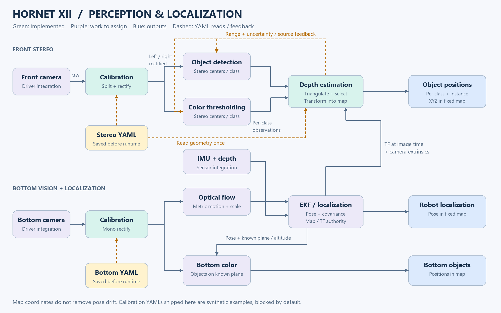

# Hornet XII PL

**Perception and Localization · ROS 2 Jazzy · subteam development repository**

This repository turns the Hornet XII P&L framework into clear work packages. One node role has one top-level folder. Only **calibration/rectification** and **depth estimation** are implemented. Other node folders intentionally contain a README describing the work to assign; they do not contain pretend implementations. `hornet_interfaces/` is a shared message package, not another node.

Inspired by the modular camera architecture in [Hornet 9](https://github.com/hornetxauv/h9_camera_ws/tree/b2f5b65507e74cbada62e6a44cd9a10d4445c809). This code is newly written for Jazzy and the framework below. It does not copy Hornet 9's machine-specific paths, older launch wiring, model weights, or calibration measurements.

## Framework



[Scalable SVG](docs/images/framework.svg) · [System overview](docs/images/system-overview.svg) · [Editable diagram source](docs/architecture.mmd)

1. The front camera driver publishes one side-by-side stereo image. The calibration node splits and rectifies it with previously measured left/right YAML files.
2. Object detection and front color thresholding each find **associated centers in both rectified images**, then publish one topic per object class.
3. Depth estimation triangulates the centers, estimates stereo uncertainty, selects the preferred method, and transforms the result into `map` at the image timestamp. It publishes one position topic and one selection-feedback topic per class.
4. The bottom camera has a separate instance of the same calibration node. Its rectified image feeds optical flow and bottom color thresholding.
5. The localization owner fuses IMU/depth and metric optical-flow information, maintains the pose/TF chain, and defines the map origin. Bottom object positions additionally require a known plane or altitude and correct camera geometry.

Dashed arrows in the diagram represent configuration reads or feedback. Focal length and stereo baseline are saved in YAML and read once by consumers; there are **no continuously published focal-length/baseline topics**. “Calibration” in the runtime graph means applying saved calibration. A separate offline tool estimates it before deployment.

**Map coordinates are metric coordinates in a fixed frame, not camera-relative XYZ and not values scaled to 0–1.** Expressing a point in `map` does not remove localization drift or calibration error. The current covariance describes pixel-induced stereo uncertainty conditional on exact robot pose/calibration; it is not a ground-truth error bound.

## Repository and assignment board

| Folder | Deliverable / owner task | Status |
|---|---|---|
| [front_camera_node/](front_camera_node/README.md) | Integrate the front side-by-side camera driver | To assign; README only |
| [bottom_camera_node/](bottom_camera_node/README.md) | Integrate the bottom camera driver | To assign; README only |
| [calibration_node/](calibration_node/README.md) | Offline calibration tool and runtime front/bottom rectification | Implemented; vehicle calibration and pool validation required |
| [object_detection_node/](object_detection_node/README.md) | ML detection, stereo matching, stable instance identity | To assign; README only |
| [front_color_thresholding_node/](front_color_thresholding_node/README.md) | Per-object HSV segmentation and stereo centers | To assign; README only |
| [depth_estimation_node/](depth_estimation_node/README.md) | Sparse stereo geometry, uncertainty, source selection, map transform | Implemented; integration and pool validation required |
| [optical_flow_node/](optical_flow_node/README.md) | Metric bottom-camera motion with scale and rotation compensation | To assign; README only |
| [sensor_bridge_node/](sensor_bridge_node/README.md) | IMU, magnetic field, pressure/depth frames, units and timestamps | To assign; README only |
| [ekf_localization_node/](ekf_localization_node/README.md) | Sensor fusion, map origin, TF, localization uncertainty | To assign; README only |
| [bottom_color_thresholding_node/](bottom_color_thresholding_node/README.md) | Bottom object segmentation and map-plane localization | To assign; README only |
| [hornet_interfaces/](hornet_interfaces/README.md) | Shared message contracts; changes reviewed by producer and consumer owners | Implemented; no runtime node |

Members should begin with [CONTRIBUTING.md](CONTRIBUTING.md), [topic contracts](docs/interfaces.md), and their folder README. Use the [node work issue template](.github/ISSUE_TEMPLATE/node-work.md) to assign work; no member usernames have been invented. The repository is not a complete robot workspace and does not launch the unimplemented roles.

## Topic contract at a glance

`<type>` is one of `gate`, `yellow_flare`, `orange_flare`, `blue_flare`, `red_flare`, `blue_drum`, `red_drum`. Edit the depth YAML list and producer implementations together when the competition classes are finalized.

| Topic | Message | Producer → consumer |
|---|---|---|
| `/front/image_raw` | `sensor_msgs/msg/Image` | Front driver → front calibration instance |
| `/front/left/image_rect`, `/front/right/image_rect` | `sensor_msgs/msg/Image` | Front calibration → both detection methods |
| `/front/detections/<type>` | `hornet_interfaces/msg/StereoObservation` | Object detection → depth estimation |
| `/front/color/<type>` | `hornet_interfaces/msg/StereoObservation` | Front color thresholding → depth estimation |
| `/objects/<type>/position` | `hornet_interfaces/msg/ObjectPosition` | Depth estimation → mission/mapping consumers |
| `/perception/selection/<type>` | `hornet_interfaces/msg/SourceSelection` | Depth estimation → both detection methods |
| `/bottom/image_raw` → `/bottom/image_rect` | `sensor_msgs/msg/Image` | Bottom driver → calibration → flow / bottom color |
| `/localization/odometry` | `nav_msgs/msg/Odometry` | Planned localization → consumers |
| `/bottom/objects/<type>/position` | `hornet_interfaces/msg/ObjectPosition` | Planned bottom color → mission/mapping consumers |

Each stereo observation contains the class, source, calibration ID, physical-instance ID, four pixel coordinates, acquisition timestamp, confidence, and pixel uncertainty. A class can have several instances; each is a separate message. Both methods must share instance identities before the depth node can compare them. The depth node does not infer correspondence between arbitrary left/right detections.

## Implemented components: build inside your own workspace

Target: **Ubuntu 24.04, ROS 2 Jazzy, system Python 3.12**. Commands below assume Jazzy is already installed. Deactivate Conda before using ROS packages.

```bash
source /opt/ros/jazzy/setup.bash
sudo apt update
sudo apt install python3-colcon-common-extensions python3-rosdep \
  python3-opencv python3-numpy python3-yaml ros-jazzy-cv-bridge \
  ros-jazzy-tf2-ros ros-jazzy-usb-cam ros-jazzy-rqt-image-view

mkdir -p ~/hornet_ws/src
cd ~/hornet_ws/src
# Clone the private repository with your normal GitHub credentials.
git clone https://github.com/Hirrus177013/Hornet-XII-PL.git
cd ~/hornet_ws
# Run sudo rosdep init once if rosdep has never been initialized on this machine.
rosdep update
rosdep install --from-paths src --ignore-src -r -y
colcon build --symlink-install --packages-up-to hornet_depth
source install/setup.bash
```

`colcon` discovers the three supplied packages directly in this checkout. Do not create a nested workspace inside the repository. The interface package is generated before the Python consumers. YAMLs and launch files are included in the package installation.

### Calibrate first

The three YAMLs in `calibration_node/config/examples/` are **synthetic test examples**. Runtime nodes reject them by default. Do not replace the example flag with `false` to make them look measured. Use your own camera calibration or run the included offline tool:

```bash
ros2 run hornet_calibration calibrate_cameras \
  --mode stereo --left-dir ~/calibration_images/left --right-dir ~/calibration_images/right \
  --board-cols 9 --board-rows 6 --square-size-m 0.025 \
  --output-dir ~/hornet_calibration/front_run_01

ros2 run hornet_calibration calibrate_cameras \
  --mode mono --images-dir ~/calibration_images/bottom \
  --board-cols 9 --board-rows 6 --square-size-m 0.025 \
  --output-dir ~/hornet_calibration/bottom_run_01
```

The board settings are examples: measure your actual square size and count **inner corners**. Use matching stereo filenames, synchronized captures, varied board poses, fixed focus, and the deployment capture mode. At least 12 accepted views are required by default. Existing output directories are never overwritten. See the [calibration procedure](calibration_node/README.md).

### Run the implemented nodes

Run each command in a separate terminal after sourcing Jazzy and your workspace. These examples require the camera owners' publishers; they do not start drivers.

```bash
ros2 launch hornet_calibration rectify.launch.py \
  left_yaml:="$HOME/hornet_calibration/front_run_01/left.yaml" \
  right_yaml:="$HOME/hornet_calibration/front_run_01/right.yaml"

ros2 launch hornet_calibration rectify.launch.py mode:=bottom_mono \
  node_name:=bottom_calibration input_topic:=/bottom/image_raw \
  bottom_yaml:="$HOME/hornet_calibration/bottom_run_01/bottom.yaml"

ros2 launch hornet_depth depth.launch.py \
  left_yaml:="$HOME/hornet_calibration/front_run_01/left.yaml" \
  right_yaml:="$HOME/hornet_calibration/front_run_01/right.yaml"
```

Depth estimation also requires detection observations and an exact-time TF chain to the **rectified left optical frame**. Until the localization/extrinsic work is supplied, it reports selection feedback and withholds map positions. It never substitutes an identity transform or the latest robot pose.

## Development and validation

Local geometry/calibration tests do not require ROS:

```bash
python3 -m pip install -r requirements-test.txt
python3 -m unittest discover -s tests -v
```

The CI file runs the same tests plus Python syntax checks. It does not claim to validate a ROS build or real cameras. The [integration checklist](docs/validation.md) covers Jazzy message generation/build, topic compatibility, timing, extrinsics, source handover, map invariance, held-out calibration, and measured object positions. Do those checks before calling the system vehicle-ready.

## Storage and contribution rules

- Version node source, schemas, small configuration, documentation, and measured YAMLs with provenance.
- Keep bags, calibration captures, datasets, model weights, and generated build/install/log outputs out of Git. Document their storage location and version instead.
- Preserve image timestamps and use the shared frame/topic contracts. Changes need review from both sides of an interface.
- Do not commit access tokens. Repository visibility is private; no team members are added automatically.
- No open-source license has been chosen for this private team project. Package metadata uses `LicenseRef-Proprietary`; replace the maintainer contact placeholder before releasing packages.

See [architecture and frame conventions](docs/frames.md), [implementation notes](docs/design-decisions.md), and [primary references](docs/references.md).
